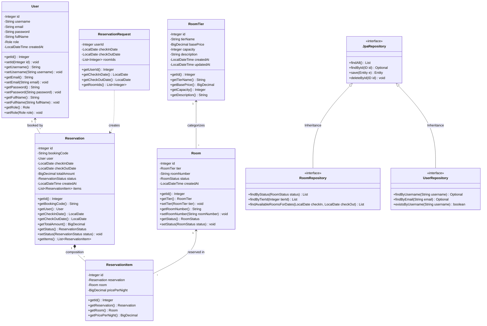

# 📋 PRA-LAPORAN PROPOSAL & RANCANGAN TUGAS BESAR PBO (UTS)
**Mata Kuliah:** Praktikum Pemrograman Berorientasi Objek (PBO)  
**Topik Proyek:** Sistem Manajemen & Reservasi Hotel Berbasis Web Enterprise (Spring Boot + MySQL + Bootstrap)  

---

## 📑 1. Identitas Proyek & Judul Aplikasi
* **Judul Aplikasi:** **Grand Palace Hotel Management & Smart Reservation System (GP-Hotel)**
* **Platform:** Web Application (REST API + Interactive Single Page Web Interface)
* **Teknologi Backend:** Java 17, Spring Boot Framework 3.2.0, Spring Data JPA, Hibernate, Jakarta Persistence
* **Teknologi Database:** MySQL Relational Database (`hotel_db`)
* **Teknologi Frontend:** HTML5, CSS3, JavaScript (Fetch API), Bootstrap 5, Bootstrap Icons
* **Tema Aplikasi:** Otomasi alur bisnis perhotelan, manajemen stok unit kamar bertingkat (*tiered inventory*), pencegahan overbooking dinamis berbasis tanggal riil, serta sistem persetujuan (*approval mechanism*) transaksi oleh admin.

---

## 💡 2. Latar Belakang & Ide Proposal
Pada sistem reservasi hotel konvensional, sering kali terjadi permasalahan **overbooking** (satu kamar dipesan ganda pada rentang tanggal yang sama) serta lambatnya sinkronisasi data ketersediaan kamar antara tamu dan staf hotel. Selain itu, aspek keamanan data sering terabaikan di mana customer dapat melihat transaksi customer lainnya.

Proyek **Grand Palace Hotel System** hadir dengan solusi:
1. **Penerapan PBO Murni & Enterprise Framework:** Memanfaatkan konsep *Encapsulation*, *Inheritance*, *Polymorphism*, dan *Abstraction* (Interface/Abstract Class) pada arsitektur Spring Boot.
2. **Smart Availability Querying:** Menghitung ketersediaan kamar secara riil dari database berdasarkan irisan tanggal check-in dan check-out.
3. **Approval Flow (Accept / Reject):** Setiap reservasi dari tamu berstatus `PENDING` terlebih dahulu, memberi kendali penuh kepada Admin untuk menyetujui atau menolak pesanan.
4. **Manajemen Stok Fleksibel:** Kemampuan penambahan stok unit kamar secara masal (*bulk stock*) per tipe kamar.
5. **Zero Data Leakage:** Isolasi data ketat berbasis HTTP Session.

---

## 🎯 3. Daftar Fitur Lengkap Aplikasi

### A. Fitur Modul Pengguna & Autentikasi (Auth & User Management)
1. **Registrasi Mandiri Tamu:** Calon tamu dapat mendaftar mandiri (otomatis mendapatkan peran `CUSTOMER`).
2. **Session-Based Login & Logout:** Mengamankan kredensial user menggunakan HTTP Session bawaan Java Servlet.
3. **Role-Based Access Control (RBAC):** Pemisahan hak akses antara `ADMIN` dan `CUSTOMER`.
4. **Manajemen Akun oleh Admin:** Admin dapat menambah user atau staf baru serta menentukan peran akun.
5. **Self Profile Management:** User dapat memperbarui nama, email, dan password sendiri.
6. **Data Privacy (Zero Leak):** Daftar seluruh user di-hide total dari tampilan tamu/customer dan dilindungi status 403 Forbidden di backend.

### B. Fitur Modul Inventaris & Stok Kamar (Inventory & Stock CRUD)
1. **Manajemen Tipe Kamar (Room Tiers):** Full CRUD tipe kamar (nama kelas, harga dasar per malam, kapasitas tamu, deskripsi).
2. **Box Monitoring Stok Real-time:** Menampilkan total unit kamar, jumlah kamar tersedia (*Available*), terisi (*Occupied*), dan dalam perbaikan (*Maintenance*).
3. **Tambah Stok Masal (Bulk Addition):** Admin dapat menambahkan 4, 5, atau lebih kamar sekaligus ke tipe kamar tertentu dengan penomoran kamar otomatis.
4. **Full CRUD Unit Kamar:** Tambah kamar satuan, edit nomor & kelas kamar, hapus kamar, serta ubah status operasional instan.
5. **Pencarian & Filter Instan:** Filter status kamar dan pencarian nomor kamar secara real-time di antarmuka.

### C. Fitur Modul Reservasi & Transaksi Cerdas (Smart Reservation & Approval)
1. **Kalkulator Biaya Multi-Malam Dinamis:** Menghitung otomatis: $\text{Lama Menginap} \times \text{Jumlah Kamar} \times \text{Tarif Base Tier}$.
2. **Anti-Overbooking Date Engine:** Query JPA yang memastikan kamar yang telah di-ACC tidak muncul pada rentang tanggal yang bertabrakan.
3. **Two-Step Approval Flow:** Pesanan masuk dengan status `PENDING` $\rightarrow$ Admin memeriksa dan memilih **Accept** (Status jadi `CONFIRMED`) atau **Reject** (Status jadi `CANCELLED`).
4. **Isolasi Riwayat Transaksi:** Customer hanya dapat melihat riwayat pemesanan atas nama ID akunnya sendiri; Admin dapat melihat seluruh transaksi hotel.
5. **Pembatalan Mandiri:** Customer dapat membatalkan pesanan selama statusnya masih `PENDING` atau `CONFIRMED`.
6. **Invoice Digital Siap Cetak (PDF):** Cetak bukti resmi pemesanan hotel lengkap dengan kode booking, nama tamu, kamar, dan total tarif.
7. **Dashboard Eksekutif Admin:** Statistik pendapatan omset (Rp), tingkat okupansi kamar (%), dan jumlah booking aktif/pending.

---

## 👥 4. Pembagian Tugas & Tanggung Jawab Anggota Kelompok
Sesuai instruksi tugas, **setiap anggota wajib bertanggung jawab minimal satu fitur (membuat class, interface/abstract class, dan memprogram kodenya)**, tidak hanya UI/UX:

| No | Peran / Anggota | Fitur yang Dikerjakan | Class & Komponen yang Diprogram | Penerapan Konsep PBO |
| :---: | :--- | :--- | :--- | :--- |
| **1** | **Anggota 1** *(Lead / Auth & User Module)* | - Autentikasi & Session<br>- Registrasi Customer & Admin<br>- Pengaturan Profil Akun | - `User.java` (Entity)<br>- `UserRepository.java` (Interface)<br>- `UserController.java` (Controller) | *Encapsulation, Interface Inheritance (`JpaRepository`), Session Abstraction* |
| **2** | **Anggota 2** *(Room & Stock Management)* | - CRUD Tipe Kamar<br>- Monitoring Stok Tiap Tier<br>- Fitur Tambah Stok Masal (*Bulk*) | - `RoomTier.java` (Entity)<br>- `RoomTierRepository.java` (Interface)<br>- `RoomTierController.java` (Controller) | *Data Modeling, Transactional Handling (`@Transactional`), Abstraction* |
| **3** | **Anggota 3** *(Room Unit & Status Engine)* | - CRUD Unit Kamar Fisik<br>- Kontrol Status Kamar Cepat<br>- Live Filtering & Search | - `Room.java` (Entity)<br>- `RoomRepository.java` (Interface + Custom Query)<br>- `RoomController.java` (Controller) | *Relationship Mapping (`@ManyToOne`), Custom Query Optimization (`@Query`)* |
| **4** | **Anggota 4** *(Reservation & Approval Module)* | - Smart Booking Multi-Malam<br>- Approval Flow (Accept / Reject)<br>- Invoice Digital & Cetak PDF<br>- Isolasi Riwayat Transaksi | - `Reservation.java` (Entity)<br>- `ReservationItem.java` (Entity)<br>- `ReservationRepository.java`<br>- `ReservationItemRepository.java`<br>- `ReservationController.java`<br>- `ReservationRequest.java` (DTO) | *Inheritance & Polymorphism, Object Composition (`OneToMany`), Data Isolation Logic* |

---

## 🧬 5. Penerapan Wajib Prinsip PBO (Inheritance, Abstract Class, & Interface)

### A. Interface & Abstraction
1. **`JpaRepository<T, ID>` (Spring Data JPA Interface):**
   - Menggunakan konsep interface polymorphism enterprise di mana `UserRepository`, `RoomTierRepository`, `RoomRepository`, `ReservationRepository`, dan `ReservationItemRepository` mewarisi fungsi-fungsi abstraksi database dari `JpaRepository`.
2. **`WebMvcConfigurer` (Interface):**
   - Diimplementasikan oleh `DatabaseConfig` untuk mengabstraksi aturan keamanan jaringan dan konfigurasi CORS lintas platform.

### B. Inheritance (Pewarisan)
* **Hirarki Repository:**
  ```
  org.springframework.data.repository.Repository<T, ID>
         ▲
         │ (Inherits)
  org.springframework.data.jpa.repository.JpaRepository<T, ID>
         ▲
         ├────── UserRepository
         ├────── RoomRepository
         ├────── RoomTierRepository
         └────── ReservationRepository
  ```
* **Base Entity / Base DTO Pattern (Dapat diimplementasikan saat penulisan laporan):**
  - Membuat class `BaseEntity` (abstract class) yang memiliki atribut `#id`, `#createdAt`, `#updatedAt` dan diturunkan (*inherited*) oleh `User`, `RoomTier`, `Room`, dan `Reservation`.

### C. Encapsulation
* Seluruh atribut data dibuat dengan access modifier **`private`** (`-id`, `-username`, `-password`, dll).
* Akses data hanya melalui method **`public` getter dan setter** dengan validasi logika bisnis.

---

## 📊 6. Class Diagram Lengkap (UML)



### Keterangan Access Modifier & Notasi UML:
* `-` : **Private** (Hanya bisa diakses di dalam class itu sendiri)
* `+` : **Public** (Dapat diakses oleh class lain dari luar package/class)
* `#` : **Protected** (Dapat diakses di package yang sama atau subclass turunannya)
* `<|--` : **Inheritance / Generalization** (Hubungan pewarisan class/interface)
* `*--` : **Composition** (Keterikatan kuat; jika Reservation dihapus, ReservationItem ikut terhapus)
* `<--` : **Association / Relasi** (Hubungan referensi antar objek)
* `..>` : **Dependency** (Class menggunakan data dari class lain sebagai payload/DTO)

---

## 📅 7. Timeline Pengerjaan Proyek (Feasible Schedule)

| Minggu / Fase | Target Pekerjaan | Luaran (Output) |
| :---: | :--- | :--- |
| **Minggu 1** | - Perancangan ide, proposal, dan skema database MySQL (`hotel_db`).<br>- Penyiapan konfigurasi environment Spring Boot & Maven. | `pom.xml`, `application.properties`, file SQL database. |
| **Minggu 2** | - Pembuatan Entity Class (`User`, `RoomTier`, `Room`, `Reservation`).<br>- Pembuatan Repository Interfaces (`JpaRepository`) dan Query kustom. | Modul Domain & Data Access Layer selesai. |
| **Minggu 3** | - Pengembangan Controller API (Auth, User, Room, Tier, Reservation).<br>- Implementasi logika persetujuan (Accept / Reject) dan isolasi role. | REST API berfungsi penuh via Postman / Unit Test. |
| **Minggu 4** | - Integrasi UI Bootstrap 5 (Single Page Application interaktif).<br>- Fitur Cetak Invoice PDF, kalkulator tarif real-time, dan stok masal. | Antarmuka web frontend terhubung sempurna dengan backend. |
| **Minggu 5** | - Pengujian menyeluruh (*stress test*, bug fixing).<br>- Penyusunan dokumen laporan akhir berformat PDF dan pembuatan presentasi. | Laporan PDF final dan aplikasi siap didemokan. |

---

## 📌 8. Checklist Verifikasi Kelayakan Laporan
- [x] Judul aplikasi jelas dan menarik.
- [x] Daftar fitur terurai rinci (Auth, Stok, Overbooking Engine, Approval Flow, Invoice).
- [x] Class Diagram lengkap dengan atribut, tipe data, method, access modifier (`+`, `-`), dan relasi (`Inheritance`, `Composition`, `Association`).
- [x] Terdapat penerapan **Inheritance** (`JpaRepository`, Base Model).
- [x] Terdapat penerapan **Interface** (`UserRepository`, `RoomRepository`, dll).
- [x] Pembagian tugas jelas dan terukur untuk setiap anggota kelompok.
- [x] Timeline pekerjaan terstruktur dan dapat dicapai (*feasible*).

